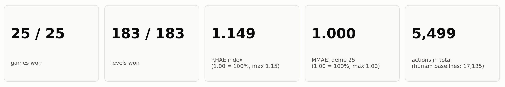
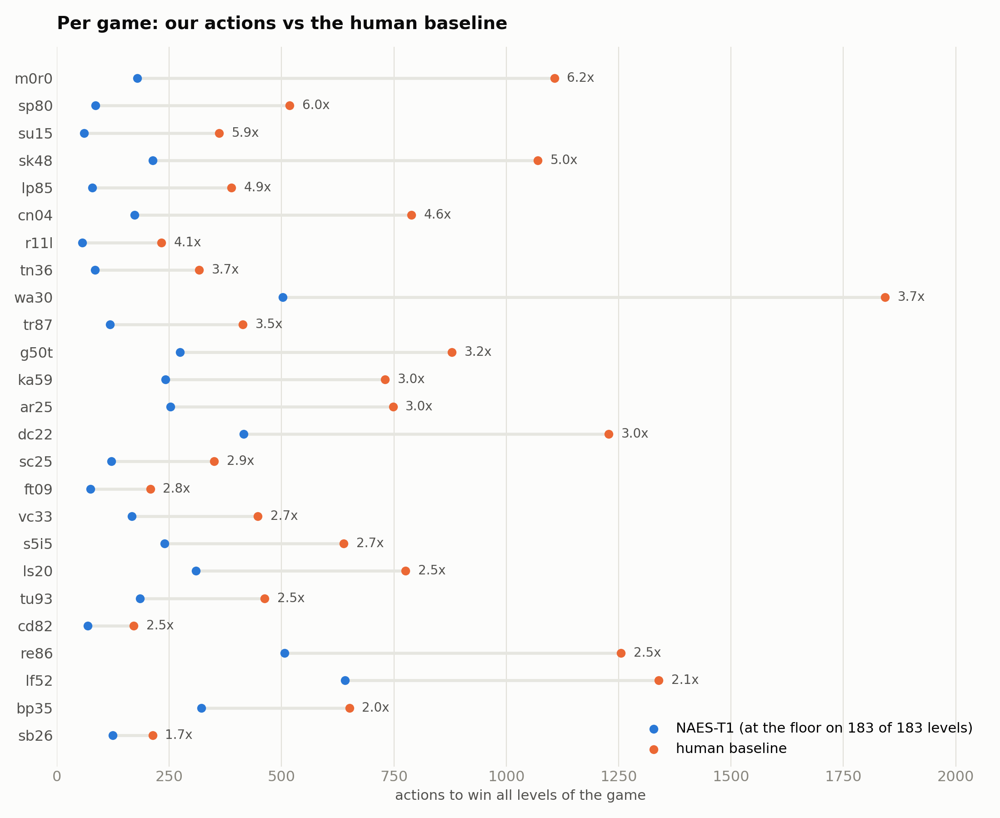
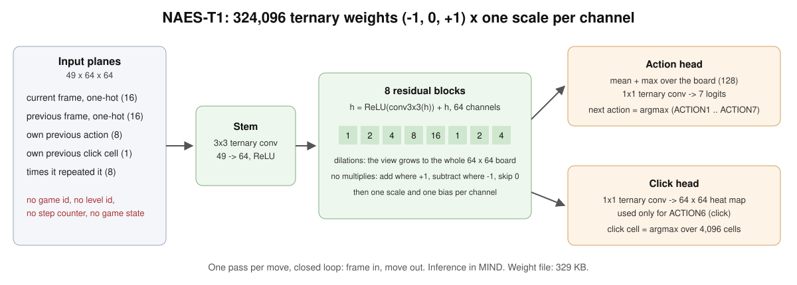
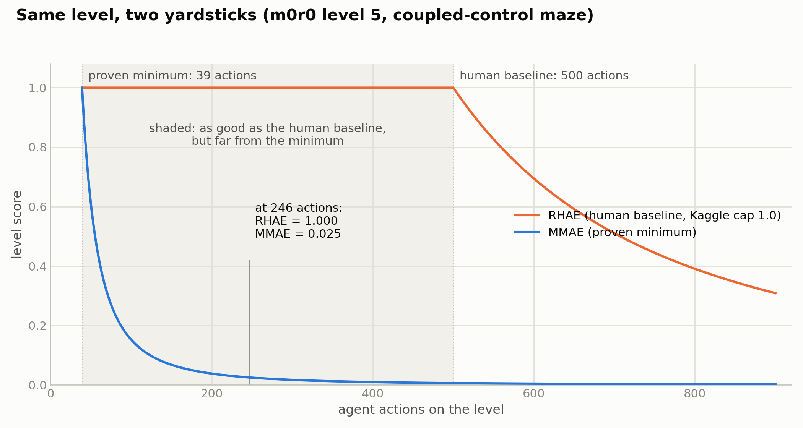
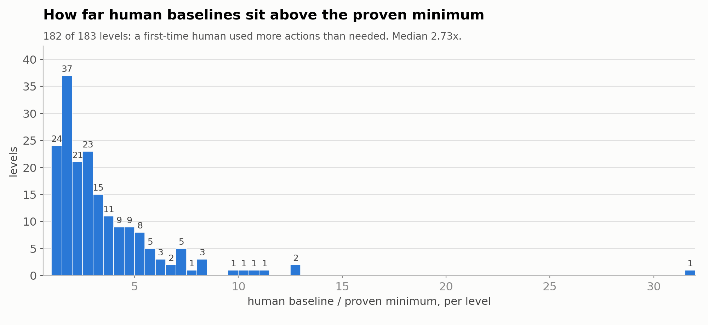
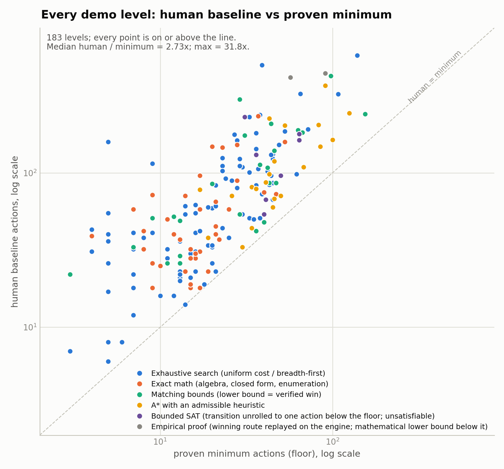
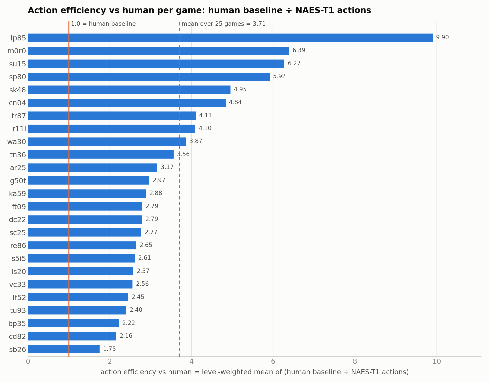
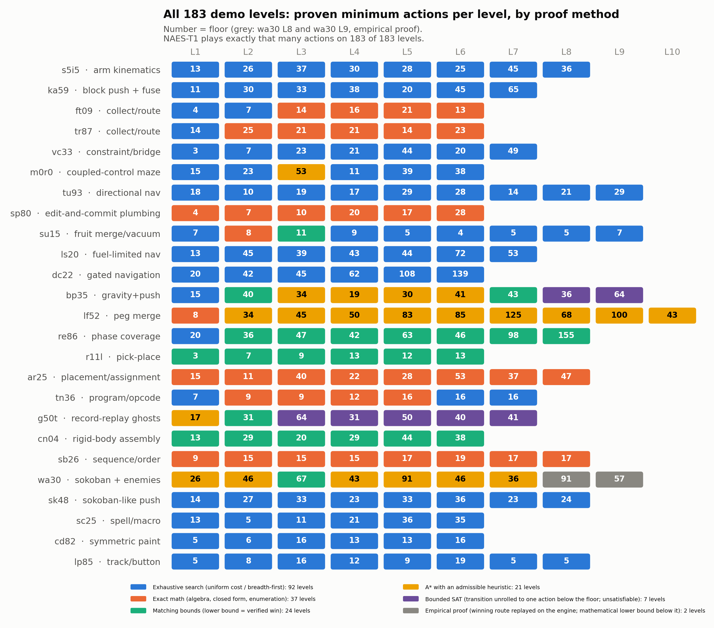
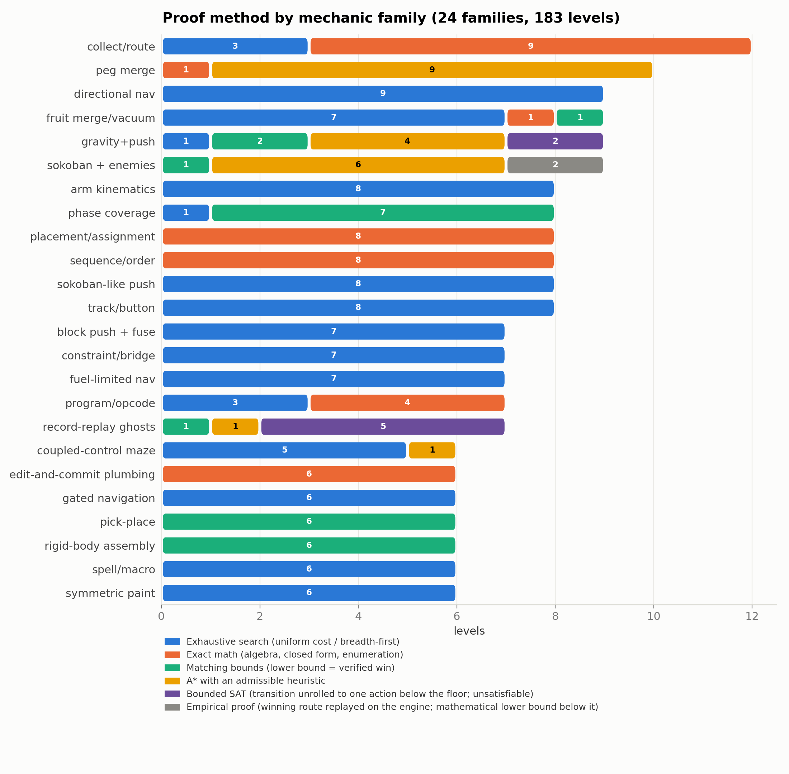
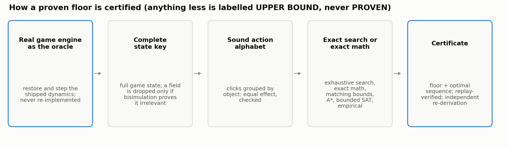

<p align="center">
  <picture>
    <source media="(prefers-color-scheme: dark)" srcset="docs/img/naes-t1-mark-on-dark.svg">
    
  </picture>
</p>

# NAES-T1

**A 324,096-weight ternary network, written in MIND, that wins all 183 levels of the 25 public ARC-AGI-3 demo games from pixels, under the Kaggle competition rules. Plus [MMAE](#mmae-the-proven-machine-minimum): a score measured against the proven machine minimum.**

[](LICENSE)
[](https://mindlang.dev)
[](results/2026-11-19/SUMMARY.json)
[](docs/MMAE.md)
[](https://arcprize.org/scorecards/46dc8e53-0718-4182-84a9-88ffe31e282e)
[](https://huggingface.co/star-ga/naes-t1)
[](https://mindlang.dev/demo/naes-t1/) [](https://star.ga/research/naes-t1) [](https://youtu.be/gFOnDSJ8E2g)
[](https://www.kaggle.com/code/cputer/naes-t1-arc-agi-3) -b31b1b.svg)




**[Scorecard](https://arcprize.org/scorecards/46dc8e53-0718-4182-84a9-88ffe31e282e) on the ARC Prize platform: 100.00%, 183/183 levels, 25/25 games, 5,499 actions** (live Competition Mode run through the ARC Prize API on the public demo set, tags STARGA, MIND, NAES-T1, agent). Measured by STARGA, not yet verified by ARC Prize.

NAES-T1 is a small policy network by [STARGA, Inc.](https://star.ga) It looks at the rendered 64 x 64 game frame and returns the next move: one pass per move, closed loop, frame in, move out. Every weight is -1, 0 or +1 times one scale per channel, so a move needs almost no multiplies, and the whole model is a 329 KB file. Inference is written in [MIND](https://mindlang.dev), our deterministic systems language and compiler: the same input gives the same move on every machine.

## Results: the 25 public ARC-AGI-3 demo games

Public demo set: 100.00%, 183 of 183 levels, 25 of 25 games and 5,499 actions. Measured by STARGA, not yet verified by ARC Prize. The per-game counts are in the table below. The per-level counts are in data/demo25_levels_mmae.csv. NAES-T1 was trained on the mechanics of these 25 games, so the score is not a result on games with unseen mechanics.

- **183 of 183 levels won**, 25 of 25 games complete.
- **5,499 actions** in total, plus the one opening RESET per game. The human baselines for the same 183 levels add up to **17,135 actions**, so NAES-T1 needs about 3.1 times fewer.
- **RHAE (Relative Human Action Efficiency) index 1.149** (the maximum is 1.15): per level (human baseline / our actions)^2, capped at 1.15, level-weighted per game, averaged over the 25 games. This is the highest RHAE index any agent can reach on these 25 games: even perfect play at every proven minimum scores 1.149, because on three levels (sb26 level 8, tu93 levels 1 and 7) the human baseline is so close to the proven minimum that (human baseline / proven minimum)^2 stays below 1.15. Every level is played in no more actions than the human baseline.
- **All 183 levels played at their floor; MMAE 1.000.** All 183 level floors are proven; 2 of them (wa30 levels 8 and 9) by empirical proof. wa30 level 8: 91 actions, sound lower bound 57. wa30 level 9: 57 actions, sound lower bound 50. For wa30 level 9, a complete check at 56 actions projects to about 10 to 30 CPU core-years. For level 8, a check of every bound up to 90 actions projects to about 300 billion CPU core-years. Both projections extrapolate measured search growth. ([details](#mmae-the-proven-machine-minimum))
- **Retail CPU cost of one full 25-game play: US$0.01.**
- Per-game records: [`results/2026-11-19/`](results/2026-11-19/). Per-level table: [`data/demo25_levels_mmae.csv`](data/demo25_levels_mmae.csv).

| Game | Mechanic family | Levels won | NAES-T1 actions | Proven minimum | Human baseline | Action efficiency vs human | MMAE |
|---|---|---|---|---|---|---|---|
| ar25 | placement/assignment | 8/8 | 253 | 253 | 748 | 3.166 | 1.000 |
| bp35 | gravity+push | 9/9 | 322 | 322 | 651 | 2.221 | 1.000 |
| cd82 | symmetric paint | 6/6 | 69 | 69 | 171 | 2.157 | 1.000 |
| cn04 | rigid-body assembly | 6/6 | 173 | 173 | 789 | 4.836 | 1.000 |
| dc22 | gated navigation | 6/6 | 416 | 416 | 1,228 | 2.788 | 1.000 |
| ft09 | collect/route | 6/6 | 75 | 75 | 208 | 2.793 | 1.000 |
| g50t | record-replay ghosts | 7/7 | 274 | 274 | 879 | 2.967 | 1.000 |
| ka59 | block push + fuse | 7/7 | 242 | 242 | 730 | 2.885 | 1.000 |
| lf52 | peg merge | 10/10 | 641 | 641 | 1,339 | 2.451 | 1.000 |
| lp85 | track/button | 8/8 | 79 | 79 | 388 | 9.905 | 1.000 |
| ls20 | fuel-limited nav | 7/7 | 309 | 309 | 776 | 2.574 | 1.000 |
| m0r0 | coupled-control maze | 6/6 | 179 | 179 | 1,107 | 6.387 | 1.000 |
| r11l | pick-place | 6/6 | 57 | 57 | 233 | 4.097 | 1.000 |
| re86 | phase coverage | 8/8 | 507 | 507 | 1,255 | 2.646 | 1.000 |
| s5i5 | arm kinematics | 8/8 | 240 | 240 | 638 | 2.613 | 1.000 |
| sb26 | sequence/order | 8/8 | 124 | 124 | 213 | 1.754 | 1.000 |
| sc25 | spell/macro | 6/6 | 121 | 121 | 350 | 2.769 | 1.000 |
| sk48 | sokoban-like push | 8/8 | 213 | 213 | 1,070 | 4.952 | 1.000 |
| sp80 | edit-and-commit plumbing | 6/6 | 86 | 86 | 518 | 5.916 | 1.000 |
| su15 | fruit merge/vacuum | 9/9 | 61 | 61 | 361 | 6.272 | 1.000 |
| tn36 | program/opcode | 7/7 | 85 | 85 | 317 | 3.561 | 1.000 |
| tr87 | collect/route | 6/6 | 118 | 118 | 414 | 4.106 | 1.000 |
| tu93 | directional nav | 9/9 | 185 | 185 | 462 | 2.401 | 1.000 |
| vc33 | constraint/bridge | 7/7 | 167 | 167 | 447 | 2.558 | 1.000 |
| wa30 | sokoban + enemies | 9/9 | 503 | 503 | 1,843 | 3.868 | 1.000 |
| **All 25** | | **183/183** | **5,499** | **5,499** | **17,135** | **3.706** | **1.000** |

Actions exclude each game's opening RESET. Human baselines are from the ARC Prize API. The RHAE index above is per level (human / agent)^2, capped at 1.15 (the ARC Prize methodology); the scorecard reports it per game as a percentage capped at 100%. Action efficiency vs human is human baseline ÷ NAES-T1 actions per level, level-weighted per game, no square and no cap, so it shows how far past the human level the play goes; the All 25 row is the mean over the 25 games. It is not the RHAE formula. MMAE is defined [below](#mmae-the-proven-machine-minimum).



## Fully legal: how NAES-T1 plays

NAES-T1 plays by every Kaggle ARC-AGI-3 competition rule, and by stricter fair-play rules of our own.

**Kaggle competition rules**

- Each game is created once. No second attempt.
- A game reset becomes a level reset. Resets are allowed, but every action keeps counting.
- Every action counts, including a click that changes nothing.
- Internet off: it runs fully offline.
- Score per level: min(human / agent, 1)^2, levels weighted by their number.

**Our own rules, stricter than the competition's**

- **Pixels only.** It sees only the rendered 64 x 64 frame. No game source code, no internal game state, no level data while playing.
- **No white box.** It never touches the game object, the game engine or its memory. It plays through the same interface a remote player uses.
- **No game ids.** No game, title, level or step number is an input or a switch. Its inputs are the current frame, the previous frame, its own previous action and click cell, and how many times in a row it repeated that action and click cell. Nothing else.
- **Weights only.** No stored solutions. The weight file holds weights, scales and biases only: no action lists, no routes, no click lists.
- **No replay.** Every move is computed from the frames of the current game.
- **One play per game.** No copying, saving or rewinding a game; no "keep the better run".
- **RESET only to continue after GAME_OVER.**
- **Deterministic.** Seeded, no wall-clock decisions; the same frames give the same moves on any machine.
- **Every number is reproducible** with the commands below.

## How it works



- **Input** (49 x 64 x 64): the current frame and the previous frame (16 colours each, one-hot), its own previous action (8, one-hot), its own previous click cell (1 plane), and how many times in a row it repeated that action and click cell (8, one-hot).
- **Stem:** one 3 x 3 ternary convolution, 49 to 64 channels, ReLU.
- **Trunk:** 8 residual blocks, h = ReLU(conv3x3(h)) + h, 64 channels, with dilations 1, 2, 4, 8, 16, 1, 2, 4, so the field of view covers the whole board.
- **Action head:** mean and max over the board (128 values), a 1 x 1 ternary convolution to 7 logits; the move is the argmax (ACTION1 to ACTION7).
- **Click head:** a 1 x 1 ternary convolution to a 64 x 64 heat map; for a click (ACTION6) the cell is the argmax over the 4,096 cells.
- **Weights:** 324,096 ternary values (194,444 non-zero) and 1,168 per-channel scales and biases, in one 329 KB file. Format: [`docs/MODEL.md`](docs/MODEL.md).

## MMAE: the proven machine minimum

ARC-AGI-3 scores an agent with RHAE: per level, the human action count divided by the agent's, squared and capped. That needs a human baseline, and a baseline describes a first-time human, not the best possible play. **MMAE (Machine-Minimum Action Efficiency)** compares the agent with the proven minimum number of actions that wins the level:

```
MMAE(level) = (proven_floor / agent_actions)^2   for a won level
MMAE(level) = 0                                  for a level not won
```

A winning run can never beat a proven minimum, so MMAE is at most 1 with no cap needed, and MMAE = 1 means the run is provably optimal. All 183 level floors are proven; 2 of them (wa30 levels 8 and 9) by empirical proof. wa30 level 8: 91 actions, sound lower bound 57. wa30 level 9: 57 actions, sound lower bound 50. For wa30 level 9, a complete check at 56 actions projects to about 10 to 30 CPU core-years. For level 8, a check of every bound up to 90 actions projects to about 300 billion CPU core-years. Both projections extrapolate measured search growth. The projected check at 56 actions for level 9 is about 2e13 to 4e13 search nodes. MMAE needs no human data, so it can score any game, including games no human has played. Definition, proof rules and method: [`docs/MMAE.md`](docs/MMAE.md).

| | RHAE | MMAE |
|---|---|---|
| Baseline | first-time human (upper median) | proven minimum |
| Needs human play | yes | no |
| Upper limit | capped (1.15 on the ARC platform, 1.0 on Kaggle) | 1.0 by construction |
| Meaning of 1.0 | as efficient as the baseline human | provably optimal |

<p>
  
  
</p>
<p>
  
  
</p>

How the floors were proven, in levels: exhaustive search (uniform cost / breadth-first) 92; exact math (algebra, closed form, enumeration) 37; matching bounds (lower bound = verified win) 24; A* with an admissible heuristic 21; bounded SAT (transition unrolled to one action below the floor; unsatisfiable) 7; Empirical proof (winning route replayed on the engine; mathematical lower bound below it) 2.

**wa30 levels 8 and 9.**

| Level | Floor | Proven lower bound |
|---|---|---|
| wa30 L9 | 57 | 50 (no win at 49 actions or fewer) |
| wa30 L8 | 91 | 57 |





## Runs

NAES-T1 needs about 25 MiB of peak resident memory for a verify run and about 45 MiB for the selftest (measured on x86-64). The source has two integer activation buffers of 4,718,592 bytes each. The reference walk needs 794,112,517 integer additions per move (about 0.79 billion): the non-zero weights times their output positions, stem, 8 blocks and action head; the click head runs only on a click. The grouped-sum kernel computes the same sums in a different grouping and gives the same decisions (see Modes below). No floating point and no GPU are required, and every device makes the same exact decisions. A full play of the 25 demo games is 5,499 moves; the games are independent, so a cluster can play them all at once. The `bench` mode times the decisions of the fixture on your own CPU and checks each one; this page states no timing.

The decision count is 5,499. A passing verify check matches every decision of the final run, and the decision-stream digest is `4d2d98f711a1209eace8f3841952e39d4d75870d48079c3175b361bba9746396`. The GPU and TPU builds are optional. Their binaries are protected: their kernel technology is part of STARGA's commercial MIND backends. The CPU build is the open-source release and reproduces every result. In short, the open CPU path is the complete system and reproduces every result; GPU inference is OPTIONAL through STARGA's commercial, protected MIND backend and NOT REQUIRED for any result. Anyone who runs the GPU build can check its decisions against the CPU build. This page states no GPU timing. Retail CPU cost of one full 25-game play: US$0.01. The aarch64 build of MIND 0.10.4 is part of the release.

## Build and run on MIND

Requires the MIND compiler `mindc` 0.10.4 or later with its `std.https` modules ([mindlang.dev](https://mindlang.dev)). The release executable is built with the native backend, a pure-MIND backend: no LLVM is needed. On aarch64 the 0.10.4 release builds with `--backend mlir`, which needs `mlir-opt`, `mlir-translate` and `clang` from LLVM 20 on `PATH`. If the compiler cannot find its standard library, set `MINDC_STD_DIR` to that directory.

The program is written in MIND: weight loading and validation, the network, the grouped-sum kernel, the verifier, the selftest with its SHA-256, the decision server, frame parsing, the HTTP, HTTPS and DNS client for the ARC API, the bench mode and the result writer. The x86-64 native unit is forty-six source files in `src/mind/`: twenty files for the network, the reference walk, the selftest, the ARC API client and the command line, ten files for the grouped-sum kernel and the bench mode (the `naes_t1_fast` and `naes_t1_bench` files that `src/unit_order.txt` names; `naes_t1_fast_stub.mind` is not one of them), and sixteen `naes_t1_mw_*` files for the multi-worker bench. The unit also holds the 31 standard-library modules that the HTTPS client imports; `src/unit_order.txt` lists the 77 files in order. From the repository root, check the weights, link the `std` directory of the compiler release as `std`, then make the unit and compile:

```console
sha256sum model/naes_t1.bin
mkdir -p build
ln -sfn /path/to/mindc-release/std std
MODS="$(sed -n 's#^std/\(.*\)\.mind$#\1#p' src/unit_order.txt | paste -sd'|')"
cat $(cat src/unit_order.txt) | grep -vE "^import std\.(${MODS});" > build/naes_t1_unit.mind
sha256sum -c src/naes_t1_unit.sha256
mindc build build/naes_t1_unit.mind --no-cache --out naes_t1
```

The `grep` line takes out the import lines of the modules that the unit holds.

The grouped-sum kernel uses 256-bit integer vector instructions (AVX2), so the native x86-64 executable needs a CPU with AVX2; every worker process of the multi-worker bench runs the same kernel. The MLIR unit is the build for other CPUs. It is the twenty sources and `naes_t1_fast_stub.mind`, which keeps the names of the kernel entry points and decides with the reference walk; it has no grouped-sum kernel and no bench mode. `src/unit_order_mlir.txt` lists its 52 files in order (the 31 standard-library modules, the twenty sources and the stub). Use it on aarch64, and on x86-64 for the build through the MLIR backend:

```console
MODS="$(sed -n 's#^std/\(.*\)\.mind$#\1#p' src/unit_order_mlir.txt | paste -sd'|')"
cat $(cat src/unit_order_mlir.txt) | grep -vE "^import std\.(${MODS});" > build/naes_t1_unit.mind
mindc build build/naes_t1_unit.mind --backend mlir --no-cache --out naes_t1
```

**Verify against the final run.** The fixture `naes_t1_fixture.bin` holds the 5,499 decision contexts of the final run (45,091,812 bytes: a 12-byte header plus 8,200 bytes per decision). Its SHA-256 is `a2dc9485252ddd922d742f7e36191fa92a20bbdb7680a2ca1c378874ecd7b925`.

```console
./naes_t1 verify model/naes_t1.bin naes_t1_fixture.bin
./naes_t1 verify model/naes_t1.bin naes_t1_fixture.bin --records > decisions.bin
sha256sum decisions.bin
```


`verify` prints `MATCH k/n`, lists the first ten mismatches and exits with status 0 only on a full match; a pass matches every decision of the final run. With `--records` it writes each 3-byte answer (action, x, y) to standard output. The stream digest is `4d2d98f711a1209eace8f3841952e39d4d75870d48079c3175b361bba9746396`. That digest is a property of the fixture, not of the machine.

**Selftest.** It reads no game data and no standard input: a seeded generator makes 64 synthetic records and the complete network, click head included, runs on each.

```console
./naes_t1 selftest model/naes_t1.bin > selftest.first.txt
./naes_t1 selftest model/naes_t1.bin > selftest.second.txt
cmp selftest.first.txt selftest.second.txt
```


A pass prints `SELFTEST_SHA256` `e0c8ae9167d99b37b00194fb3bdf5d545952ae4fc223e0c2d5be3382708d7444` and `WEIGHTS_SHA256` equal to the weight-file hash. The two runs print the same bytes. The release CI builds on x86-64 and aarch64 and requires the same selftest output on both chips.

**Decision server.** `./naes_t1 serve model/naes_t1.bin` answers one 8,196-byte request per move on standard input with a 3-byte reply, until end of file. Each process keeps no state between requests, so separate processes can serve separate games. Protocol: [`docs/MODEL.md`](docs/MODEL.md).

**Modes.** The executable has five modes: `verify`, `selftest`, `serve`, `play` and `bench`. `verify`, `serve` (without `--trace`), `play` and `bench` decide with the grouped-sum kernel. `selftest` and `serve --trace` decide with the reference walk, and so does every mode of the MLIR unit. Both walks give the same decision stream: `verify` checks the kernel against every decision of the fixture. The multi-worker bench (`bench --threads 2` and more) starts worker processes, and every worker count gives the same decision stream. How the kernel works: [`docs/MODEL.md`](docs/MODEL.md#grouped-sum-kernel).

**Bench.** The mode is in the native x86-64 build. It times the decisions of the fixture on your CPU and checks every decision:

```console
./naes_t1 bench --weights model/naes_t1.bin --fixture naes_t1_fixture.bin --batch 1 --threads 1
```

On standard output it prints `PLAN` (what the kernel built from the weights at start), `COMPARED=5499`, `MATCH 5499/5499`, `STREAM_SHA256` (the digest of the decision stream, the same value as the `verify` digest above) and `SERVE_SHA256` (the digest of the 5,499 request records built from the fixture): the same lines for every worker count. On standard error it prints `MISMATCHES_TIMED` (wrong decisions inside the timed part; 0 on a pass) and `US_PER_DECISION` (microseconds per decision in the timed part). With one worker it also prints one line for each timed window. With two or more workers it also prints `WORKER_PROCESSES` (how many worker processes ran) and `WORKER_DECISIONS` (the decisions of each worker). `--threads N` takes 1 to 24 and runs the smaller of N and the CPUs the process may use as worker processes, each on one CPU. The options `--batch` (1 or 25), `--offset` and `--limit` choose the timed windows of the one-worker run; with two or more workers they are a usage error. Exit status 0 means a full match; 1 a wrong decision; 2 a usage error; 3 rejected weights; 4 a rejected fixture or no memory; 5 an activation guard; 6 a digest failure; 7 a stream digest that differs from the recorded one; 8 a failed worker process or a record that no worker decided once (two or more workers). The time depends on your CPU.

**Release qualification.** The open-source release is the CPU build of the sources above, compiled by `mindc` 0.10.4: the x86-64 build with the native backend (46 sources, grouped-sum kernel) and the aarch64 build with `--backend mlir` (twenty sources and the stub, reference walk). The GPU and TPU builds are optional. Their binaries are protected: their kernel technology is part of STARGA's commercial MIND backends. The CPU build is the open-source release and reproduces every result. In short, the open CPU path is the complete system and reproduces every result; GPU inference is OPTIONAL through STARGA's commercial, protected MIND backend and NOT REQUIRED for any result. Anyone who runs the GPU build can check its decisions against the CPU build. A passing GPU check matches the final-run decision stream. A CPU build qualifies only when `verify` matches every decision of the final-run fixture, two selftest runs print the digest `e0c8ae9167d99b37b00194fb3bdf5d545952ae4fc223e0c2d5be3382708d7444`, and the aarch64 selftest equals the x86-64 one.

The architecture policy in [CONTRIBUTING.md](CONTRIBUTING.md) is enforced by CI.
The gate scans the MIND sources in `src/mind/`
and enforces their acyclic import graph; in a tree with no product sources it
reports the zero-source bootstrap state.

## Play

`play` runs whole games closed loop. The program parses only the settled last frame of each reply (`src/mind/naes_t1_play_json.mind`), the only frame the policy reads. Offline, against the official toolkit's local gateway (the caller opens and closes the scorecard):

```console
ARC_API_KEY=local-only ./naes_t1 play --game GAME_ID --card CARD_ID \
    --host 127.0.0.1 --port 8000 --weights model/naes_t1.bin --result game.map
```

Online, against the ARC API with your own key in `ARC_API_KEY` (sent only in the request header, never printed or logged); the HTTPS and DNS client is part of the MIND program, so no external helper is needed:

```console
./naes_t1 play --games GAME_ID1,GAME_ID2,... --card CARD_ID --weights model/naes_t1.bin
```

The 25 versioned game ids of the public demo set are the `game` fields of [`results/2026-11-19/SUMMARY.json`](results/2026-11-19/SUMMARY.json); `--games` takes them as a comma-separated list.

Plain HTTP sends the key in cleartext, so `play` uses it only with `--plain-http` or a loopback `--host` (127.0.0.0/8); any other IPv4 address as `--host` is refused, because HTTPS needs a DNS name to verify the server certificate against. `--games` plays the listed games one after the other in one process; `--max-actions N` bounds each game. Each finished game writes one line-oriented result record (`!play_result ... actions=... resets=... levels=... win_levels=... state=... code=... per_level=[...]`). The program never opens, queries or closes the scorecard and never repeats an action whose reply was lost.

## Repository layout

```
src/mind/      NAES-T1 in MIND: the 46 program files of the x86-64 native build above (SHA-256, fixed-point
               arithmetic, weight loader, network, grouped-sum kernel, bench mode, multi-worker bench, selftest, play client with
               HTTP, HTTPS and DNS, command line), naes_t1_fast_stub.mind (the stub of the MLIR unit), plus 10 test and stub files for the DNS, HTTPS and play parts, naes_t1_network_entry.mind, a verify entry of the network unit, and naes_t1_kernel_evidence.mind, the unit file of the evidence artifact
model/         naes_t1.bin, the weights (SHA-256 `fa54f507fdf9a9c74a8bc22d95a1c970e3528b3fe1707b6eb61d74bad2419fec`)
results/       per-game records (results/2026-11-19/).
data/          per-level table: proven floor, our actions, human baseline, MMAE, proof method
proofs/        the certificate folder: one record per level, methods; how to check: from each directory that contains a SHA256SUMS file, for example `cd proofs/certificates/levels && sha256sum -c SHA256SUMS`
figures/       the charts above; scripts in figures/src/ (usage line at the top of each)
docs/          MMAE.md (the measure), MODEL.md (network, grouped-sum kernel, bench output and file formats), img/ (the NAES-T1 mark shown at the top of this page)
naes_t1_fixture.bin   the 5,499 decision contexts of the final run (verify input)
WEIGHTS_FORMAT.md  where the weight file layout is described (it points to docs/MODEL.md)
.github/       CI: the selftest build and the architecture gate (see CONTRIBUTING.md)
release_evidence/  the records behind the results (play record and scorecard, model gates, lower-bound artifacts, archive index); check with: cd release_evidence && sha256sum -c SHA256SUMS
evidence/          the evidence file of the network kernel (naes_t1_kernel.mic3, mic@3 with the evidence chain, attested deterministic; SHA-256 3b31a74d78148283c7cf87e4a1a4c18a83edad0997f6c0ffcefc30d650504985; trace hash 37f53ce67c527490cc393ed651a07897c69d6f6e96582f536b81e78a7f4f3b7b); `mindc verify evidence/naes_t1_kernel.mic3 --require-deterministic` accepts it
backends/      the optional protected GPU and TPU builds (binaries) of STARGA's commercial MIND backends; check with: cd backends && sha256sum -c SHA256SUMS
community/     the public community scorecards that the paper compares with, one folder per scorecard; community_manifest.md says what the records are, community_recordings.tsv pins the recordings, regenerate_community.md gives the steps
check_community*.mind, fetch_recordings*.mind, std_*.mind   the community check and fetch programs in MIND, with their library units
src/unit_order.txt  the unit list of the x86-64 native build (CI)
src/unit_order_mlir.txt  the unit list of the MLIR build (aarch64, CI)
src/naes_t1_unit.sha256  the CI unit hash list
.arch-mind/    architecture policy (see CONTRIBUTING.md)
CONTRIBUTING.md  development checks; CI runs the architecture gate
LICENSE        Apache-2.0
```

## Weights


`model/naes_t1.bin` (329,133 bytes). Its SHA-256 is `fa54f507fdf9a9c74a8bc22d95a1c970e3528b3fe1707b6eb61d74bad2419fec`. Also on Hugging Face: [star-ga/naes-t1](https://huggingface.co/star-ga/naes-t1).

## Citation

```bibtex
@software{starga_naes_t1_2026,
  title  = {NAES-T1: a ternary ARC-AGI-3 policy in MIND, and MMAE, a score against the proven machine minimum},
  author = {{STARGA, Inc.}},
  year   = {2026},
  url    = {https://github.com/star-ga/naes-t1}
}
```

## License

Apache-2.0. See [LICENSE](LICENSE). The GPU and TPU binaries in `backends/` are STARGA's commercial MIND backends: they are protected and are not under the Apache-2.0 licence (see [backends/README.md](backends/README.md)). ARC-AGI-3 and the demo games belong to the ARC Prize Foundation; they are not included here.
