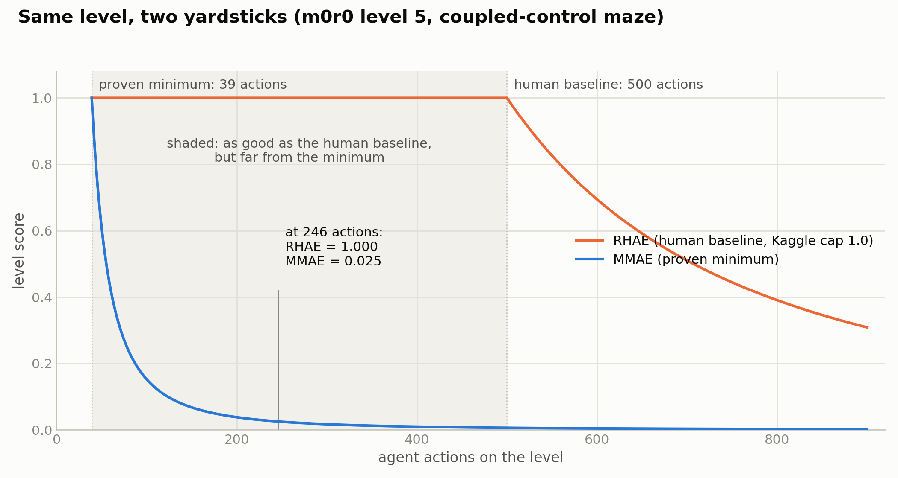
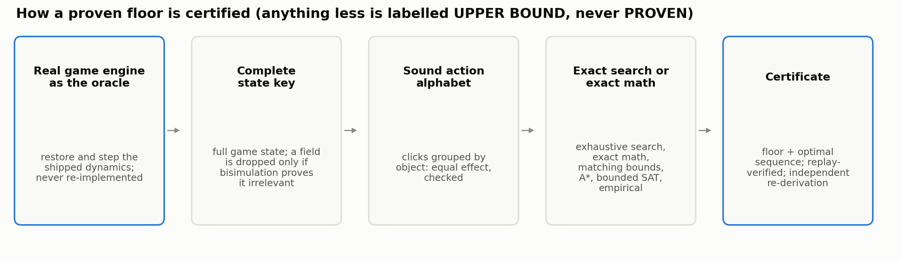
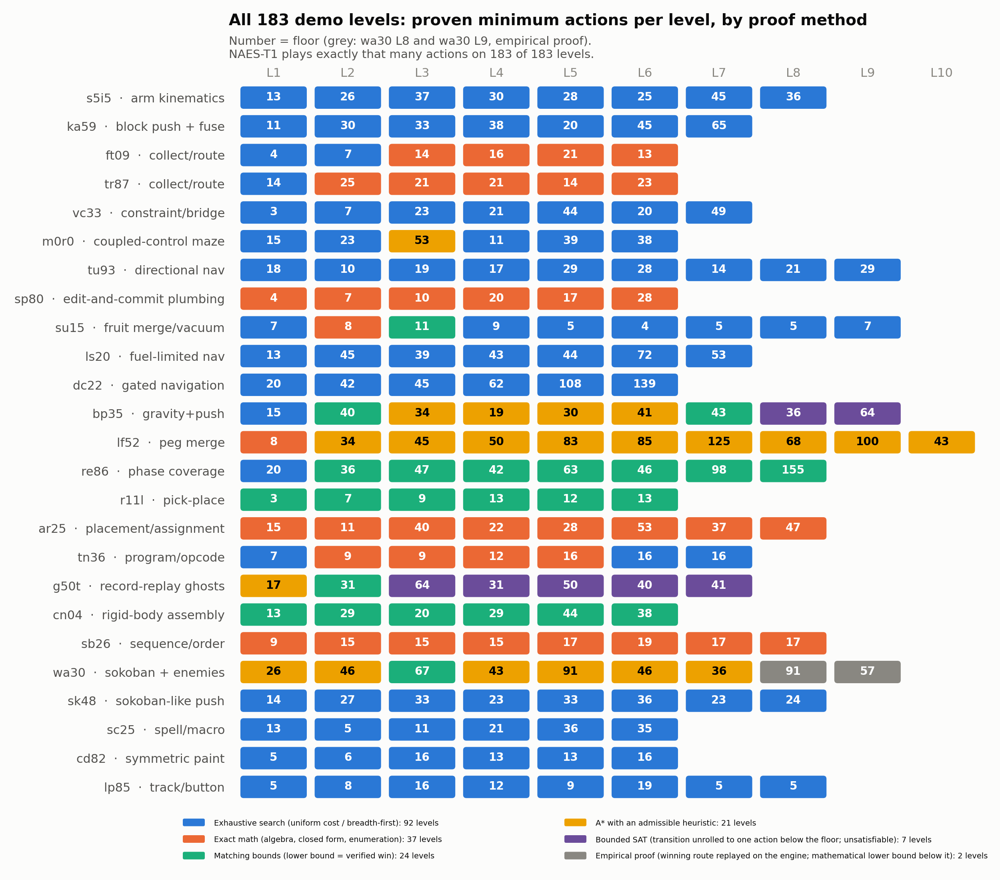
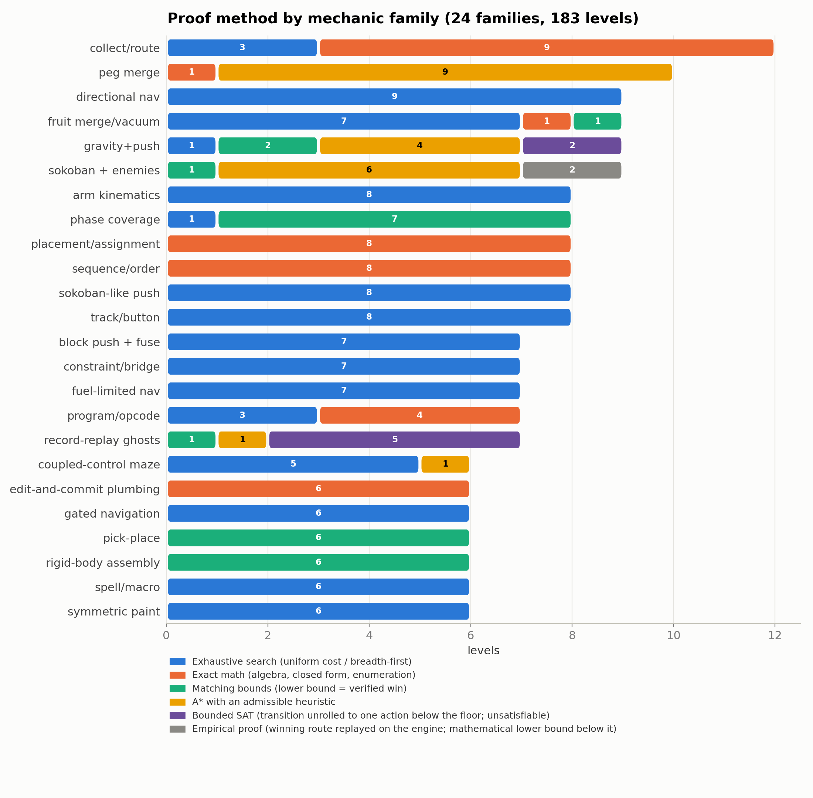
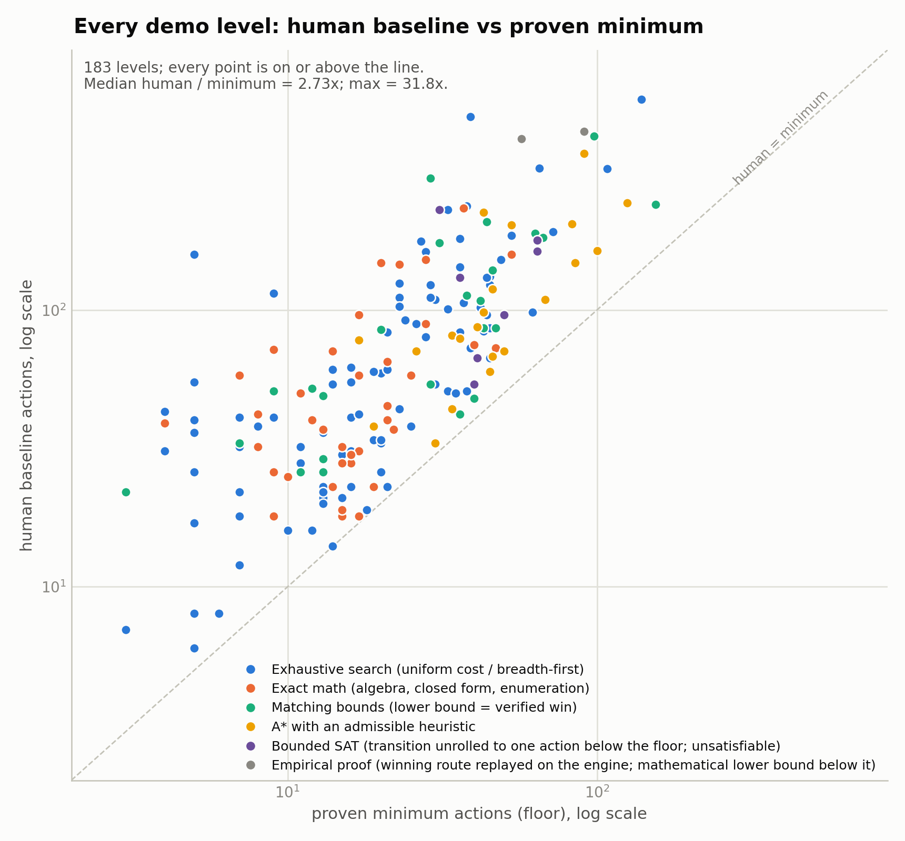
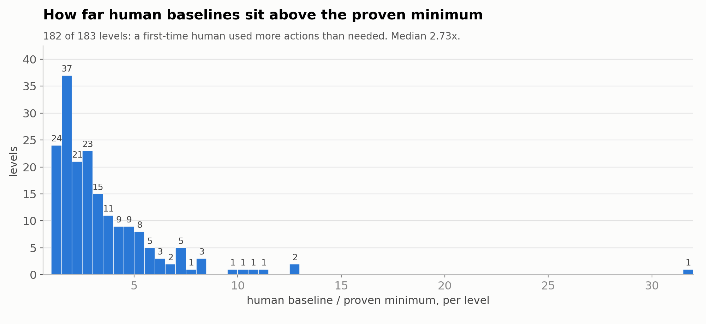

# MMAE: scoring game play against the proven machine minimum

## 1. Why a new measure

Why a new measure: what if a game has never been played by people, such as a simulated or newly generated game? The ARC-AGI-3 score compares an agent with a human baseline, so it cannot score that game. MMAE needs no human baseline: it scores any game whose floors are proven.

ARC-AGI-3 scores an agent with RHAE (Relative Human Action Efficiency): for each level, the human action count divided by the agent's action count, squared. A baseline describes a first-time human, not the best possible play.

MMAE (Machine-Minimum Action Efficiency) compares the agent with the proven minimum number of actions that wins the level.

## 2. Definition

For one level:

- `floor` = the proven minimum number of actions that wins the level from its start state.
- `MMAE(level) = (floor / agent_actions)^2` for a won level; `0` for a level not won.

Aggregation: the plain mean over graded levels (the figure we report), or the RHAE level weighting (level k has weight k) when MMAE stands in for RHAE.

Properties:

- `floor <= agent_actions` for every winning run (by definition of a minimum), so MMAE <= 1 with no cap needed.
- MMAE = 1 means the run is provably optimal: no shorter win exists.
- It needs no human data, so it scores any game, including games no human has played.

## 3. How it differs from RHAE

| | RHAE | MMAE |
|---|---|---|
| Baseline | first-time human (upper median) | proven minimum |
| Needs human play | yes | no |
| Upper limit | capped (1.15 on the ARC platform, 1.0 on Kaggle) | 1.0 by construction |
| Meaning of 1.0 | as efficient as the baseline human | provably optimal |
| Strictness | baselines sit well above the minimum | the hardest possible bar |

On the 25 public demo games, the human baselines add up to 17,135 actions over 183 levels. The floors add up to 5,499 actions. NAES-T1 wins all 183 levels in 5,499 actions, about 3.1 times fewer than the human baselines, and plays exactly the floor on all 183 levels. RHAE caps at 1.15 per level on the ARC platform and at 1.0 on Kaggle, so it cannot see that difference; MMAE can. Measured by STARGA, not yet verified by ARC Prize.

## 4. How a floor is proven (sound by construction)

A floor is a claim of minimality, so it needs a proof, not an estimate. The rules:

1. **The real game engine is the transition oracle.** The search restores and steps the game's own dynamics; it never re-implements them, so no hidden state can drift.
2. **PROVEN only from** exhaustive search (a complete search with no heuristic estimate (breadth-first, uniform-cost or layered) over the game states, on the engine or on a reduced model whose merged states a stated equivalence or dominance lemma justifies, closes every cost below the floor), exact math (a closed form, a dynamic program, a complete enumeration over the solution descriptions of the full game (end configurations, placements, programs, merge trees, rotation assignments) with every case priced exactly, or a constraint system over end configurations shown to have no solution gives the lower bound; no game rule is dropped), matching bounds (a lower bound at the start state from a relaxation (a model with a game rule dropped), a coverage count or an admissible heuristic already equals the length of a replayed winning route), A* (a complete best-first search of the A* family (A*, iterative-deepening A* or proof-number search) with an admissible heuristic; closed per algorithm: for A*, every state whose estimated total cost is below the floor was expanded; for iterative-deepening A*, every cost bound below the floor was searched to exhaustion; for proof-number search, the search proved that no win exists below the floor; no search finds a win below the floor), bounded SAT (the game transition is unrolled step by step to one action below the floor, and every such formula is unsatisfiable on the current instance), or empirical proof (a winning route replayed on the game engine, with a proven lower bound published beside it).
3. **Complete state keys.** Two different game states can render the same screen. A screen-only key merges them and can hide the true shortest win. The key is the complete game state; a field is dropped only when a bisimulation check proves it changes no successor.
4. **Click games.** Clicks inside one object have the same effect, so the click alphabet collapses from 4,096 points to one representative per object, after a homogeneity check.
5. **Structure first.** Many mechanic families have exact math for their minimum: toggle grids reduce to linear algebra over GF(k) (clicks commute; cost = the sum of click counts); rotation grammars have closed forms; navigation and push levels close by a sandwich, where a verified win (upper bound) equals an admissible relaxation (lower bound: relaxed grid distance, minimum-cost box-to-goal matching).
6. **Determinism.** No wall-clock budget inside any search; node and iteration budgets only, so a proof replays bit for bit on any machine.
7. **Invariants and adversarial checks.** A floor above any real winning run is unsound and is rejected; every new floor is re-derived by an independent verifier on the live engine. There is exactly one floor per level.

Proving a floor uses the game engine itself, the way a referee would. That is measurement only. A playing agent never sees it; NAES-T1 plays from frames.

## 5. Empirical proof

Empirical proof: a winning route replayed on the game engine, with a proven lower bound published beside it. The floor of such a level stays in the MMAE mean. All 183 level floors are proven; 2 of them (wa30 levels 8 and 9) by empirical proof.

## 6. Results on the 25 public demo games

- Public demo set: 100.00%, 183/183 levels, 25/25 games, 5,499 actions. Measured by STARGA, not yet verified by ARC Prize.
- 183 of 183 levels won. NAES-T1 was trained on the mechanics of these 25 games, so the score is not a result on games with unseen mechanics.
- All 183 level floors are proven; 2 of them (wa30 levels 8 and 9) by empirical proof. wa30 level 8: 91 actions, sound lower bound 57. wa30 level 9: 57 actions, sound lower bound 50. For wa30 level 9, a complete check at 56 actions projects to about 10 to 30 CPU core-years. For level 8, a check of every bound up to 90 actions projects to about 300 billion CPU core-years. Both projections extrapolate measured search growth. The projected check at 56 actions for level 9 is about 2e13 to 4e13 search nodes.
- All 183 levels played exactly at their floor; MMAE 1.000 (plain mean over the 183 levels); 5,499 actions in total.
- How the floors were proven, in levels: exhaustive search (uniform cost / breadth-first) 92; exact math (algebra, closed form, enumeration) 37; matching bounds (lower bound = verified win) 24; A* with an admissible heuristic 21; bounded SAT (transition unrolled to one action below the floor; unsatisfiable) 7; Empirical proof (winning route replayed on the engine; mathematical lower bound below it) 2.
- Floors closed by a SAT check are bp35 level 8, bp35 level 9, g50t level 3, g50t level 4, g50t level 5, g50t level 6 and g50t level 7. All 100 g50t level 7 queries at bound 40 have checker certificates in `proofs/` (85 checked by the verified LRAT checker cake_lpr, 15 by drat-trim). The other SAT rows record solver UNSAT answers.

Mechanic families: [`data/demo25_families.md`](../data/demo25_families.md). Full per-level table (game, level, mechanic family, proven floor, our actions, human baseline, MMAE, proof method): [`data/demo25_levels_mmae.csv`](../data/demo25_levels_mmae.csv).

## 7. What MMAE is for

- Scoring agents on games and levels that no human has played.
- Checkable claims: each proof keeps its optimal sequence as a certificate. A replay checks the route. Certificates are for measurement only; a player never uses them.
- An honest ceiling: MMAE = 1 is the best any agent can ever do.
